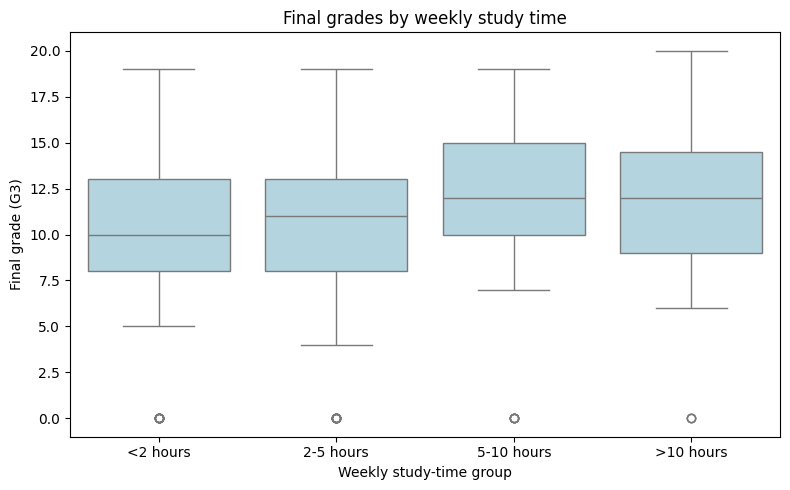
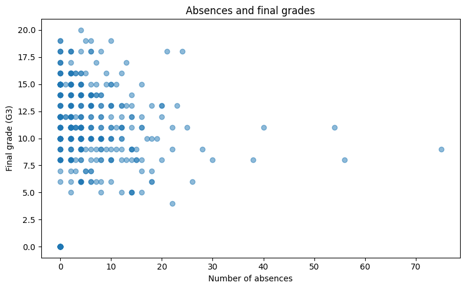
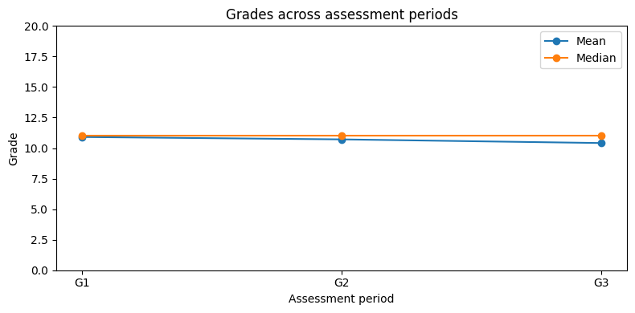

# Student Attendance, Study Habits and Academic Performance

This project explores weekly study-time groups, recorded absences and mathematics grades using Python, pandas, Matplotlib and Seaborn. It uses descriptive statistics, grouped comparisons and charts to answer three questions about the UCI Student Performance data.

The analysis is in [notebooks/analysis.ipynb](notebooks/analysis.ipynb). Its 36 code cells follow the work step by step, with saved tables and charts.

## Questions

1. How do final mathematics grades differ across weekly study-time groups?
2. How are recorded absences associated with final grades?
3. How do grades change from G1 to G2 to G3 for the same records?

## Data and scope

Only **student-mat.csv** from the [UCI Student Performance dataset](https://archive.ics.uci.edu/dataset/320/student+performance) is analysed. The file contains **395 student mathematics records and 33 original columns** from two Portuguese secondary schools. There are 349 GP records and 46 MS records. The source combines school reports and questionnaires.

One row represents one student mathematics record. The Portuguese language subject file is not used or combined with this sample. The original CSV and variable notes are included unchanged in [data/raw/](data/raw/).

| Field     | Meaning                                                                     | Use in this project                              |
| --------- | --------------------------------------------------------------------------- | ------------------------------------------------ |
| studytime | Weekly category: 1 = <2 hours; 2 = 2-5 hours; 3 = 5-10 hours; 4 = >10 hours | Compare final-grade distributions across groups  |
| absences  | Number of school absences                                                   | Describe counts and their association with G3    |
| G1        | First-period grade, 0-20                                                    | Describe grades and calculate changes            |
| G2        | Second-period grade, 0-20                                                   | Describe grades and calculate changes            |
| G3        | Final-year grade issued at the third period, 0-20                           | Main grade used in group and absence comparisons |
| school    | School code, GP or MS                                                       | Sample context and a code check                  |
| age       | Age in years                                                                | Range check only                                 |

Study-time codes are ordered categories, not exact hour measurements. Absences are counts; the file does not provide the total possible attendance exposure needed for an attendance rate.

## Analysis steps

The notebook:

1. Loads the semicolon-separated CSV and inspects its shape and column types.
2. Checks missing values, repeated rows, allowed codes and documented ranges.
3. Summarises absences and grades with counts, means, medians, standard deviations, quartiles and extremes.
4. Compares final grades across study-time groups, showing group sizes and distributions.
5. Calculates Pearson and Spearman correlations between absences and final grades, including a separate positive-final-grade comparison.
6. Compares assessment summaries and calculates grade differences within the same records.
7. Checks group and direction totals and compares two ways of calculating the mean grade change.
8. Saves seven result tables and six chart images.

Tables are built one column at a time. The descriptive statistics use the normal `describe()` layout: variables on columns and statistics on rows.

## Data checks

| Check            | What is checked           | Issues found |
| ---------------- | ------------------------- | -----------: |
| Missing cells    | All 33 source columns     |            0 |
| Repeated rows    | Exact full-row duplicates |            0 |
| School codes     | GP or MS                  |            0 |
| Ages             | 15-22, inclusive          |            0 |
| Study-time codes | 1, 2, 3 or 4              |            0 |
| Absence counts   | 0-93, inclusive           |            0 |
| Grades           | G1, G2 and G3 within 0-20 |            0 |

All 395 records are kept. No values are imputed, and no rows or valid extreme values are removed. The observed absence range is 0-75. A zero grade is within the documented scale and is retained.

The notebook displays the issue counts for inspection; it does not automatically stop when a count is positive. If the input file changes, investigate any issues before continuing. These checks establish the listed conditions, not the accuracy of every source value. The file has no explicit student identifier, so matching a few characteristics would not justify deleting a record.

## Findings

### Final grades by study-time group

| Weekly study time  | Records | Mean G3 / 20 | Median G3 / 20 |
| ------------------ | ------: | -----------: | -------------: |
| Less than 2 hours  |     105 |        10.05 |             10 |
| 2-5 hours          |     198 |        10.17 |             11 |
| 5-10 hours         |      65 |        11.40 |             12 |
| More than 10 hours |      27 |        11.26 |             12 |

The 5-10-hour group has the highest observed mean, followed by the >10-hour group. The pattern is not a steady increase across categories, and the distributions overlap. Group sizes range from 27 to 198 records.

The box plot shows medians and the spread within each group. Means are reported in the table. These comparisons do not establish an optimal study-hour target or a causal effect of study time.



### Absences and final grades

| Sample                        | Records | Pearson r | Spearman rho |
| ----------------------------- | ------: | --------: | -----------: |
| All records - main comparison |     395 |     0.034 |        0.018 |
| G3 > 0 - extra comparison     |     357 |    -0.213 |       -0.244 |

Pearson describes a linear relationship; Spearman describes a rank-based tendency. Both full-sample values are close to zero. This does not establish that attendance is irrelevant or rule out other relationships.

The zero-grade counts are:

| Assessment | Records with grade zero |
| ---------- | ----------------------: |
| G1         |                       0 |
| G2         |                      13 |
| G3         |                      38 |

All 38 records with G3 = 0 also have zero recorded absences. They overlap at the same (0, 0) point in the scatter plot. The supplied variable notes do not explain the pattern.

The G3 > 0 comparison shows what happens when those records are left out. Selecting records using the final grade changes the sample and can introduce selection bias. The smaller-group correlations are a sensitivity check, not a correction to the main result. The full sample remains the main analysis.



### Grades across assessment periods

| Assessment | Records | Mean grade / 20 | Median grade / 20 |
| ---------- | ------: | --------------: | ----------------: |
| G1         |     395 |           10.91 |                11 |
| G2         |     395 |           10.71 |                11 |
| G3         |     395 |           10.42 |                11 |

Mean grades decline across the recorded assessments, while the median remains 11. These summaries use the same 395 records. The chart joins the period means and medians, rather than individual student paths.



### Changes within the same records

Each change is the later grade minus the earlier grade on the same row. A positive value means an increase, zero means no recorded change, and a negative value means a decrease.

| Comparison | Mean change in grade points | Increased | Unchanged | Decreased |
| ---------- | --------------------------: | --------: | --------: | --------: |
| G1 to G2   |                       -0.19 |       128 |       117 |       150 |
| G2 to G3   |                       -0.30 |       111 |       194 |        90 |
| G1 to G3   |                       -0.49 |       143 |        93 |       159 |

Each row accounts for all 395 records. From G1 to G3, 36.20% increase, 23.54% remain equal and 40.25% decrease, rounded to two decimal places. The observed first-to-final changes range from -12 to +4 grade points.

Because G1, G2 and G3 are related recorded grades, including a final-year grade, their differences do not directly measure learning gained or lost.

## Run the analysis

Use **Python 3.12** and extract the complete project ZIP. Open a terminal in the extracted `student-academic-performance` folder.

Create a virtual environment:

```bash
python -m venv .venv
```

Activate it using the command for your terminal:

| Terminal               | Activation command               |
| ---------------------- | -------------------------------- |
| Windows PowerShell     | `.\.venv\Scripts\Activate.ps1` |
| Windows Command Prompt | `.venv\Scripts\activate.bat`   |
| macOS / Linux          | `source .venv/bin/activate`    |

Install the packages, enter the notebook folder and open the analysis:

```bash
python -m pip install -r requirements.txt
cd notebooks
python -m notebook analysis.ipynb
```

Restart the kernel and run all cells from the top. The notebook expects its working directory to be **notebooks**. Its `../` paths go up to the project root to reach `data/raw`, `results` and `images`. Keep those included folders in place.

The raw data are included, so running the analysis requires no dataset download. Installing the packages requires internet access. The final cells overwrite the generated CSV tables; the plotting cells recreate the PNG images. The saved notebook also contains outputs for reading without rerunning it.

The required versions are listed in [requirements.txt](requirements.txt): pandas 2.2.3, Seaborn 0.13.2, Matplotlib 3.10.8, SciPy 1.17.0 and Jupyter Notebook 7.6.5. SciPy supports the Spearman calculation used through pandas.

## Project files and outputs

| Path                                                | Contents                                      |
| --------------------------------------------------- | --------------------------------------------- |
| [notebooks/analysis.ipynb](notebooks/analysis.ipynb) | Analysis, explanations and saved outputs      |
| [data/raw/student-mat.csv](data/raw/student-mat.csv) | Unchanged mathematics source data             |
| [data/raw/student.txt](data/raw/student.txt)         | Original variable documentation               |
| [DATA_SOURCE.md](DATA_SOURCE.md)                     | Source links, definitions and dataset licence |
| [requirements.txt](requirements.txt)                 | Required Python packages                      |

Seven CSV tables are saved in [results/](results/):

| File                                                            | Contents                                            |
| --------------------------------------------------------------- | --------------------------------------------------- |
| [data_quality_checks.csv](results/data_quality_checks.csv)       | Counts from the seven data checks                   |
| [descriptive_statistics.csv](results/descriptive_statistics.csv) | Descriptive statistics for absences, G1, G2 and G3  |
| [studytime_summary.csv](results/studytime_summary.csv)           | Group counts, grade summaries and sample shares     |
| [zero_grade_counts.csv](results/zero_grade_counts.csv)           | Zero-grade counts by assessment                     |
| [absence_correlations.csv](results/absence_correlations.csv)     | Full-sample and selected-sample correlations        |
| [grade_period_summary.csv](results/grade_period_summary.csv)     | Counts, averages, spread and extremes by assessment |
| [grade_change_summary.csv](results/grade_change_summary.csv)     | Paired changes, direction counts and percentages    |

Six PNG charts are saved in [images/](images/):

- [Grade distributions](images/grade_distributions.png)
- [Final grades by study-time group](images/studytime_final_grades.png)
- [Absence distribution](images/absence_distribution.png)
- [Absences and final grades](images/absences_final_grades.png)
- [Mean and median grade trends](images/grade_period_trend.png)
- [First-to-final grade-change distribution](images/grade_change_distribution.png)

## Verification

On 19 November 2026, all 36 code cells were executed in order in a fresh Python process, with no errors. All seven generated CSV tables matched the uploaded results within rounding tolerance. Both raw files remained unchanged, and all six charts were regenerated. The analysis code is unchanged from the uploaded notebook.

The notebook itself prints row and group totals, adds the direction counts for each comparison, and compares the mean paired change with the difference between the period means. Interactive Jupyter launch, Windows desktop interaction and a clean-machine installation have not been verified in the execution environment.

The results can support descriptive reporting and questions for further investigation. They do not identify an optimal study target or justify decisions about individual students. Clarifying how zero grades and absences were recorded would improve the attendance interpretation.

## Source and licence

Cortez, P. (2008). **Student Performance** [Dataset]. UCI Machine Learning Repository. [https://doi.org/10.24432/C5TG7T](https://doi.org/10.24432/C5TG7T).

The source data are distributed under [Creative Commons Attribution 4.0 International (CC BY 4.0)](https://creativecommons.org/licenses/by/4.0/). Credit remains with the dataset creator. The raw CSV and original variable notes are unchanged; the tables and charts are derived from those data. No endorsement by UCI or the creator is implied. Further source information is in [DATA_SOURCE.md](DATA_SOURCE.md).
